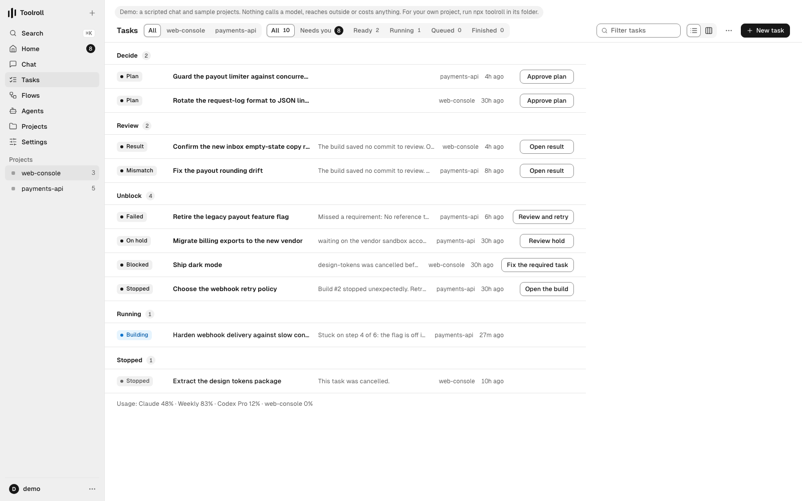

<div align="center">

<picture>
  <source media="(prefers-color-scheme: dark)" srcset="docs/media/wordmark-dark.svg">
  
</picture>

### Your agents build. You decide.

For Claude Code, Codex and Gemini, on your own machine.<br>
Approve each plan once. Get results back Ready with the diff, the check status and screenshots.

[](https://www.npmjs.com/package/toolroll)
[](https://github.com/ap9000/toolroll/actions/workflows/ci.yml)
[](LICENSE)
[](https://github.com/ap9000/homebrew-toolroll)


**[Website](https://toolroll.dev)** · [Docs](docs/guide/README.md) · [For agents](docs/agents.md) · [Use cases](https://toolroll.dev/use-cases) · [Changelog](CHANGELOG.md)

<picture>
  <source media="(prefers-color-scheme: dark)" srcset="docs/media/ui/tasks-dark.png">
  
</picture>

<sub>Every task across every project, and the one thing each needs from you. (Demo workspace.)</sub>

</div>

## Quick start

macOS or Linux, Node.js 22.13+, git 2.41+, and Claude Code (`claude`) or
Codex (`codex`) signed in on this computer.

```sh
curl -fsSL https://raw.githubusercontent.com/ap9000/toolroll/main/install.sh | sh
```

or

```sh
npm install -g toolroll    # or: brew install ap9000/toolroll/toolroll
toolroll
```

Toolroll opens in your terminal and runs while that window is open. No
password and no login file: on your own computer you're already in. Started
in a git repository, that repository is your project; press `n` for a first
task, approve the plan, and the result comes back **Ready**. Elsewhere, add a
project with `toolroll repos add <folder>`, or open the browser (press `w`, or
run `toolroll --web`), which also offers a sample project. To look around
first, `toolroll demo` opens a seeded sandbox with no model calls and no spend.
More: [Getting started](docs/guide/getting-started.md).

## How it works

```
 describe ─▶ plan ─▶ approve ─▶ build ─▶ check ─▶ Ready ─▶ you decide
                       you       agent   exact     diff     Complete,
                                         commit    + checks send back or merge
```

1. **Describe** the outcome in Chat, the terminal or your phone.
2. **Plan.** Toolroll reads the repository and drafts the goal, what's out of
   bounds, the requirements, and the exact agent and model.
3. **Approve** once. Nothing spends until you do; changing the terms asks again.
4. **Build.** An agent works on its own branch. A judgement call
   becomes a question for you, not a guess.
5. **Check.** Your project's own check runs on the exact commit.
6. **Ready.** The diff, the check log and screenshots. Mark it Complete, send
   it back with what to change, or merge through the pull request.

Approving work you start on this computer needs no password. Hands-off modes,
merging, releasing and most settings ask you to set one first: `toolroll password set`.

## Use cases

**Clear the backlog overnight.** Queue the tasks you never get to. Each builds
under its approved scope, in parallel, and recovers by itself after a
restart. You wake up to results, not transcripts.

**Ship behind a real check.** Your project's command decides what passes, on
the exact commit being released. A deploy refuses anything that wasn't
checked and marked Complete.

**Decide from your phone.** Plans, questions and results arrive in Telegram,
Slack, Discord or Teams with buttons. One tap answers; the build resumes.

**Triage issues as they arrive.** A new GitHub or Linear issue starts a card
in a flow. Jev, a small sorting model, triages it; real bugs become tasks you approve.

**Repeat work on a schedule.** Dependency bumps, coverage, docs drift: a
scheduled flow files the same approved terms each time, with a per-run budget
and an optional 7-day cost ceiling.

**Run one server for the team.** Each engineer signs in with your identity
provider or their own API token, sees only their projects, and reaches it from
the CLI or MCP. Every act lands in one ledger.

## Why Toolroll

- **You approve scope once.** The approval binds to the exact goal, bounds,
  criteria, agent and model. No model sits in any approval path.
- **Evidence, not trust.** Ready shows the result and its check status;
  merging needs the project's required check to pass on that exact result. A
  failed check stays failed.
- **Your machine, your logins.** Agents use the Claude and Codex subscriptions
  you already have. An OS-level fence keeps them away from Toolroll's secrets.
- **Any agent.** Claude Code, Codex, Gemini and OpenRouter, routed per phase.
- **Open source.** MIT. Your data is one SQLite file on your disk.

## Features

| Area | What you get |
|---|---|
| **Approvals** | Digest-bound scopes, password step-up, typed decisions with reversibility, expiring operating modes |
| **Agents** | Claude Code, Codex, Gemini, OpenRouter; an exact model per phase; subscription or API key |
| **Models** | One editor (Settings → Models): "Sized by job" by default (Haiku for small tasks, Sonnet for routine, Opus for large or risky, Opus plans and reviews), or "Opus for everything"; every change shown before → after and logged |
| **Surfaces** | Web console (desktop and phone), CLI, Telegram, Slack, Discord, Teams, MCP |
| **Flows** | Zones on a canvas; triggers from schedules, GitHub, Linear, webhooks, email and chat; scripts, drafts, AI triage |
| **Team** | Team server, OpenID Connect sign-in, per-person API tokens, project grants, subagents |
| **Audit** | Hash-chained action ledger (`toolroll ledger verify`), evidence packs, full export |
| **Spend** | A Spend page in Settings: API dollars, plan usage and unknown cost kept apart, by project, model, role and person, with CSV export; monthly limits, plan windows, zero tokens while idle |
| **Safety** | Agent fence on Anthropic's sandbox-runtime (Seatbelt, bubblewrap) and Codex's sandbox, per-scope network and write rules, keychain-sealed secrets, per-run tool broker |
| **Operations** | Crash recovery, backups and restore, Prometheus metrics, OpenTelemetry traces |

## For agents

Toolroll is built to be driven by agents. Every command answers `--json`
with one envelope and a stable `reason`; exit codes are `0` ok, `1` broke,
`2` usage, `3` the answer is no; every mutation takes `--key`.

```sh
toolroll contract --commands --json   # the whole command surface
toolroll skills get operating         # the rules, from the binary you're running
```

Start at [docs/agents.md](docs/agents.md). [`llms.txt`](llms.txt) indexes the
docs for language models.

## Docs

- [Getting started](docs/guide/getting-started.md): install, first task, terminal, desktop app
- [Tasks, results and revisions](docs/guide/tasks.md)
- [Chat and your phone](docs/guide/chat-and-phone.md)
- [Flows](docs/guide/flows.md) · [Steps that reach outside](docs/guide/steps-outside.md) · [Subagents](docs/guide/subagents.md)
- [Running unattended](docs/guide/unattended.md) · [Fleets and trackers](docs/guide/fleet.md)
- [Security](docs/guide/security.md) · [Models, spend and routing](docs/guide/routing.md)
- [A team server](docs/team-server.md) · [Linux](docs/guide/linux.md)
- [All docs](docs/guide/README.md)

Coming from Standing Orders? Same product, renamed. The `standing-orders`
command and your data keep working.

## Contributing

Provider adapters are the most useful place to start. See
[CONTRIBUTING.md](CONTRIBUTING.md). Report security issues as
[SECURITY.md](SECURITY.md) describes.

## License

[MIT](LICENSE)
