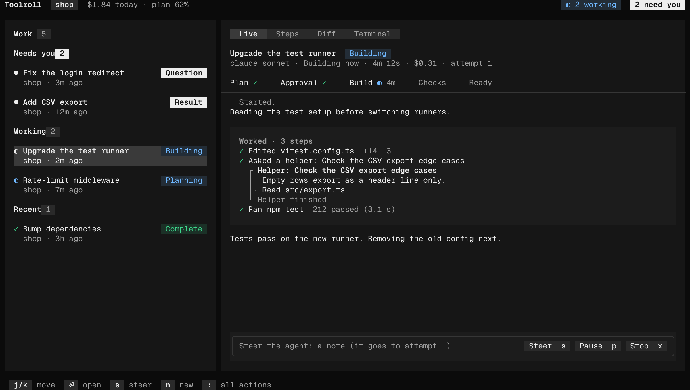

<div align="center">

<picture>
  <source media="(prefers-color-scheme: dark)" srcset="https://raw.githubusercontent.com/ap9000/toolroll/main/docs/media/wordmark-dark.svg">
  
</picture>

### Your agents build. You decide.

**Delegate changes. Review verified diffs. Ship in one keystroke — in the native macOS app or your terminal.**

<picture>
  <source media="(prefers-color-scheme: light)" srcset="https://raw.githubusercontent.com/ap9000/toolroll/main/docs/media/terminal-workbench-light.png">
  
</picture>
<sub>Native SwiftUI macOS app and keyboard-driven terminal workbench, zero Electron, zero telemetry.</sub>

For Claude Code, Codex, and Gemini — using the subscriptions already on your machine.

[](https://www.npmjs.com/package/toolroll)
[](https://github.com/ap9000/toolroll/actions/workflows/ci.yml)
[](https://github.com/ap9000/toolroll/blob/main/LICENSE)
[](https://github.com/ap9000/homebrew-toolroll)


**[Website](https://toolroll.dev)** · [Docs](https://github.com/ap9000/toolroll/blob/main/docs/guide/README.md) · [For agents](https://github.com/ap9000/toolroll/blob/main/docs/agents.md) · [Use cases](https://toolroll.dev/use-cases) · [Changelog](CHANGELOG.md)

</div>

## Quick start

### CLI & Terminal Workbench (macOS or Linux)

Requires Node.js 22.20+, git 2.41+, and Claude Code (`claude`), Codex (`codex`), or Gemini signed in on this computer. On Linux (64-bit), also install the sandbox tools: `sudo apt update && sudo apt install bubblewrap socat ripgrep bash debianutils` (other distributions: [Linux](docs/guide/linux.md#install-the-sandbox-tools)). Windows isn't supported; use WSL 2.

```sh
curl -fsSL https://raw.githubusercontent.com/ap9000/toolroll/main/install.sh | sh
```

Or with Homebrew / npm:

```sh
brew install ap9000/toolroll/toolroll   # or: npm install -g toolroll
toolroll
```

<details>
<summary>Upgrading from the older <code>standing-orders</code> npm package</summary>

```sh
npm uninstall -g standing-orders && npm install -g toolroll
```

</details>

### Native macOS app (macOS 14 Sonoma+)

Build and launch the native SwiftUI **Toolroll.app** from a checkout (requires Xcode 16 / Swift 6; automatically discovers or starts your local Toolroll engine):

```sh
cd mac && bash build-app.sh && open build/Toolroll.app
```

Signed, notarized `.dmg` downloads and Homebrew Cask distribution are configured in [macOS release & signing guide](https://github.com/ap9000/toolroll/blob/main/docs/guide/mac-release.md) and will publish automatically once Developer ID signing secrets are enabled.

Toolroll opens locally with no password and no login file — on your own computer you're already in. Start a **Direct Chat** for fast interactive iteration in an isolated clone, or delegate a **Task** to build while you walk away. Every result returns **Ready** with its diff and real check status; press `⌘⏎` (Mac app) or `a` (terminal) to accept and ship, or send it back with notes. To explore without model calls or spend, run `toolroll demo`. More: [Getting started](https://github.com/ap9000/toolroll/blob/main/docs/guide/getting-started.md).

## The terminal loop

**Install → `toolroll` → `n` → describe → Enter → build → review diff → accept.**

Enter in the new-task composer chooses **Just code** by default. Tab toggles
**Plan first**; Enter then submits that choice. Just code skips planning, not
the build terms or safety checks. Plan first drafts a scope for you to review
and approve before building.

Agents work on their own branches. A judgement call becomes a question for
you. A result becomes **Ready**, awaiting your review, with its diff and actual
check status. Accept marks it Complete; publishing and merging need their own
approvals. Set your project's check to verify the exact result.

[Coming from herdr](https://github.com/ap9000/toolroll/blob/main/docs/guide/from-herdr.md) ·
[Terminal keys and layouts](https://github.com/ap9000/toolroll/blob/main/docs/guide/getting-started.md#the-terminal-workbench)

## Use cases

**Clear the backlog overnight.** Queue the tasks you never get to. Each builds
under its approved scope, in parallel, while Toolroll keeps running. If it
stops, run `toolroll` again and each task continues from its saved work. You
wake up to results, not transcripts.

**Ship behind a real check.** Your project's command decides what passes, on
the exact commit being released. A deploy refuses anything that wasn't
checked and marked Complete.

**Decide from your phone.** Plans, questions and results arrive in Telegram,
Slack, Discord or Teams with buttons. One tap answers; the build resumes.

**Triage issues as they arrive.** A new GitHub or Linear issue starts a card
in a flow. A small triage model (Jev) sorts it; real bugs become tasks you approve.

**Repeat work on a schedule.** Dependency bumps, coverage, docs drift: a
scheduled flow files the same approved terms each time, with a per-run budget
and an optional 7-day cost ceiling.

**Run one server for the team.** Each engineer signs in with your identity
provider or their own API token, sees only their projects, and reaches it from
the CLI or MCP. Every act lands in one ledger.

## Why Toolroll

- **You approve scope once.** The approval binds to the exact goal, bounds,
  criteria, agent and model. No model sits in any approval path.
- **Evidence, not trust.** Ready shows the result and its check status;
  merging needs the project's required check to pass on that exact result. A
  failed check stays failed.
- **Your machine, your logins.** Agents use the Claude and Codex subscriptions
  you already have. An OS-level fence keeps them away from Toolroll's secrets.
- **Any agent.** Claude Code, Codex, Gemini and OpenRouter, routed per phase.
- **Open source.** MIT. Your data is one SQLite file on your disk.

## Features

| Area | What you get |
|---|---|
| **Approvals** | Digest-bound scopes, password step-up, typed decisions with reversibility, expiring operating modes |
| **Agents** | Claude Code, Codex, Gemini, OpenRouter; an exact model per phase; subscription or API key |
| **Models** | One editor (Settings → Models): "Sized by job" by default (Haiku for small tasks, Sonnet for routine, Opus for large or risky, Opus plans and reviews), or "Opus for everything"; every change shown before → after and logged |
| **Skills** | Global Skill Library (Settings → Agents and models → Skills): import GitHub skill bundles pinned to exact commit SHAs, daily auto-updates with suspicious-change holds, and one-click local mirror to Claude Code, Codex, and Gemini CLI |
| **Surfaces** | Native macOS app (SwiftUI), terminal workbench, web console (desktop & phone), CLI, Telegram, Slack, Discord, Teams, MCP |
| **Flows** | Zones on a canvas; triggers from schedules, GitHub, Linear, webhooks, email and chat; scripts, drafts, AI triage |
| **Team** | Team server, OpenID Connect sign-in, per-person API tokens, project grants, subagents |
| **Audit** | Hash-chained action ledger (`toolroll ledger verify`), evidence packs, full export |
| **Spend** | A Spend page in Settings: API dollars, plan usage and unknown cost kept apart, by project, model, role and person, with CSV export; monthly limits, plan windows, zero tokens while idle |
| **Safety** | Agent fence on Anthropic's sandbox-runtime (Seatbelt, bubblewrap) and Codex's sandbox, per-scope network and write rules, keychain-sealed secrets, per-run tool broker |
| **Operations** | Crash recovery, backups and restore, Prometheus metrics, OpenTelemetry traces |

## For agents

Toolroll is built to be driven by agents. Every command answers `--json`
with one envelope and a stable `reason`; exit codes are `0` ok, `1` broke,
`2` usage, `3` the answer is no; every mutation takes `--key`.

```sh
toolroll contract --commands --json   # the whole command surface
toolroll skills get operating         # the rules, from the binary you're running
```

Start at [docs/agents.md](https://github.com/ap9000/toolroll/blob/main/docs/agents.md). [`llms.txt`](https://github.com/ap9000/toolroll/blob/main/llms.txt) indexes the
docs for language models.

## Docs

- [Getting started](https://github.com/ap9000/toolroll/blob/main/docs/guide/getting-started.md): install, first task, terminal, desktop app
- [Tasks, results and revisions](https://github.com/ap9000/toolroll/blob/main/docs/guide/tasks.md)
- [Chat and your phone](https://github.com/ap9000/toolroll/blob/main/docs/guide/chat-and-phone.md)
- [Flows](https://github.com/ap9000/toolroll/blob/main/docs/guide/flows.md) · [Steps that reach outside](https://github.com/ap9000/toolroll/blob/main/docs/guide/steps-outside.md) · [Subagents](https://github.com/ap9000/toolroll/blob/main/docs/guide/subagents.md)
- [Running unattended](https://github.com/ap9000/toolroll/blob/main/docs/guide/unattended.md) · [Fleets and trackers](https://github.com/ap9000/toolroll/blob/main/docs/guide/fleet.md)
- [Security](https://github.com/ap9000/toolroll/blob/main/docs/guide/security.md) · [Models, spend and routing](https://github.com/ap9000/toolroll/blob/main/docs/guide/routing.md)
- [A team server](https://github.com/ap9000/toolroll/blob/main/docs/team-server.md) · [Linux](https://github.com/ap9000/toolroll/blob/main/docs/guide/linux.md)
- [All docs](https://github.com/ap9000/toolroll/blob/main/docs/guide/README.md)

## Contributing

Provider adapters are the most useful place to start. See
[CONTRIBUTING.md](https://github.com/ap9000/toolroll/blob/main/CONTRIBUTING.md). Report security issues as
[SECURITY.md](https://github.com/ap9000/toolroll/blob/main/SECURITY.md) describes.

## License

[MIT](https://github.com/ap9000/toolroll/blob/main/LICENSE)
