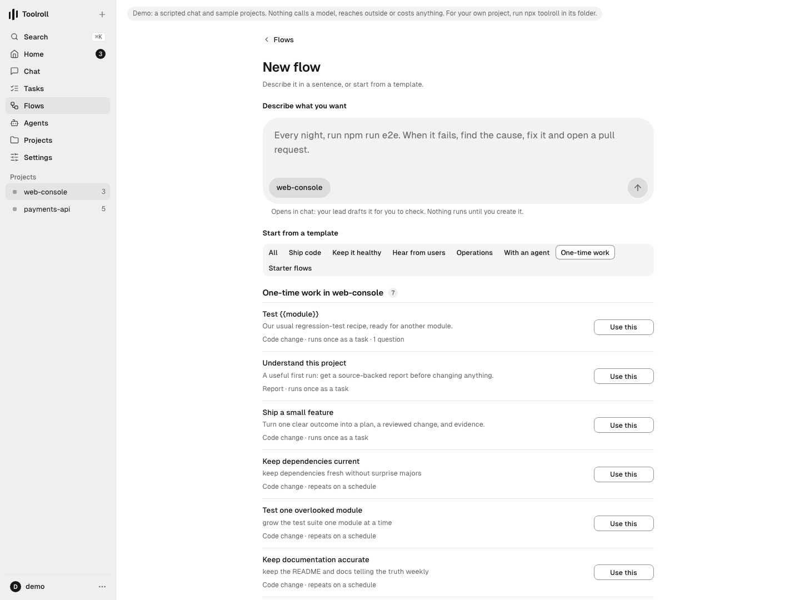
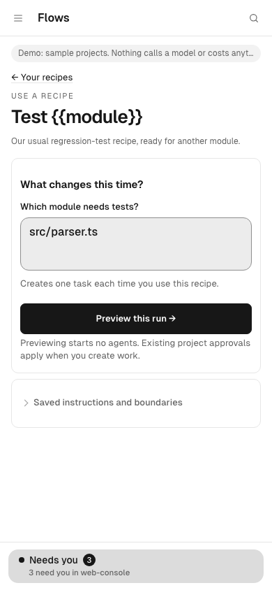
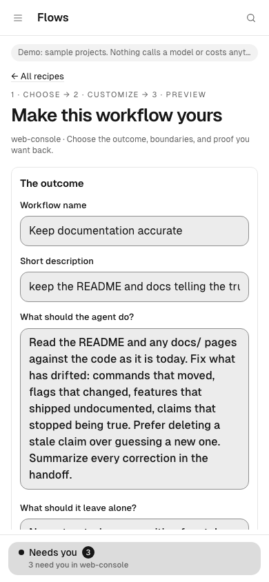

# Workflow recipes

A recipe is a saved piece of work you can run again: what the agent should do,
what to leave alone, and how you'll know it worked. Recipes live under
**Flows → New flow → One-time work**, and they go through the same tasks,
approvals, checks and recovery as any other work. (The old **Recipes** address
opens the same place.)



## Find them

Open a project, then **Flows → New flow**. Under **Start from a template**,
choose **One-time work** (on a phone, pick it from the template menu). The list
shows the project's saved recipes first, the ones used most recently on top,
then six starters:

- **Understand this project**: a source-backed report, no code changes. A
  useful first run.
- **Ship a small feature**: one clear outcome, planned, built and checked.
- **Keep dependencies current**, **Test one overlooked module**, **Keep
  documentation accurate**: these repeat on a schedule.
- **Clean up lint and types**: one sweep of mechanical fixes.

Each row says what it makes (a report or a code change) and whether it runs
once as a task or repeats on a schedule. Every row has one button, **Use this**.
Without an open project the list is still there to read, and it says to open a
project to use, save or import a recipe.

## Use a starter

**Use this** on a starter opens **Make this workflow yours**: the outcome
(name, short description, what the agent should do, what to leave alone,
allowed files or folders), the success checks, and how it should run (a code
change or a report, when to plan, run once or repeat on a schedule, an
optional weekly spending limit).

Choose **Preview workflow →** to see the steps, the terms you'd approve and
what this project and its agents are ready for. Previewing starts no agents.
Then create it: **Create task for approval**, **Create workflow** when a
signed policy approves it for you, or **Create scheduled workflow** for
repeating work. A schedule starts paused, so nothing repeats until you turn it
on from its flow.

## Use a saved recipe

**Use this** on a saved recipe asks only **What changes this time?**: one box
per question the recipe asks. A recipe without questions says it's ready to go.
Choose **Preview this run →**, check the preview, and create the work.
**Saved instructions and boundaries** shows what the recipe always does, and
**Edit a copy of this recipe →** starts a new copy from it.



Each use freezes its answers into a fresh plan, so using the recipe for another
module makes separate work, and creating the same preview twice returns the
same task. For a repeating recipe, the answers stay fixed for every run of the
schedule it creates; each use creates another scheduled flow.

## Create a recipe for work you do often

Choose **Create a recipe** below the list. Give it a name, say what the agent
should do and what success looks like. For the parts that change each time,
open **Ask something each time** and add a question. For example:

- Recipe name: `Test {{module}}`
- What should the agent do?: `Add regression tests for {{module}}, covering {{scenario}}.`
- Questions: short key `module`, “Which module?”; short key `scenario`, “Which
  behavior should the tests cover?” A default answer is optional.
- Success check: `The tests cover {{scenario}} in {{module}} and pass.`

**Insert into instructions** puts a question's placeholder at your cursor.
Answers can appear in the name, description, instructions, exclusions and
success checks; allowed paths and check commands stay fixed. Questions are for
work details, never passwords or keys. A recipe can ask up to eight.

Choose **Preview recipe →**, read **When someone uses this recipe** and
**Saved instructions**, then **Save recipe**. Saving starts no work. Two other
ways to save one: **Preview recipe to save** in a starter's editor, and **Save
as a project recipe** on a workflow preview. A task's **Reuse this plan as a
recipe →** link (under **More about this task**) copies the task's goal, exclusions, allowed paths
and success checks into the editor.



## Share a recipe

Everyone with access to the project can use its saved recipes; viewers can
read them but not save or use them. Saved copies don't change: editing makes a
new copy, and work already made from the old one is left alone. The list shows
the newest 100.

**Export recipe JSON** (on a preview) downloads a portable copy. In another
project, open **Import a shared recipe** below the One-time work list, paste it
under **Recipe JSON**, and choose **Review imported recipe**: it opens in the
editor so you can check and preview it there. An export carries only the text
you wrote (goals, checks, exclusions). It carries no project, permissions,
credentials or approvals, and unsupported fields or versions are refused.

**Made from recipes lately** below the list links the twelve most recent tasks
and flows made from recipes in this project.

## What stays the same

Recipes don't add a second way to run work:

- A preview lasts 30 minutes and is tied to you, the project and the exact
  definition; editing makes a fresh one. You can have up to 30 open previews.
- Creating work from a preview records the task or flow, any policy approval
  and a launch receipt together. A double click, lost response or restart
  returns the same work; an expired preview creates nothing new.
- Every step rechecks your current access to the project. Answers and saved
  recipes never grant access or skip the project's approval rules; teammates
  use a recipe with their own permissions.
- Work can be created while no builder is connected; the preview says it will
  wait. The task or flow page is where you inspect results, answer questions,
  stop or resume work, and pause a schedule.

Recipes don't add branching logic, outside triggers or credentials in
templates. Reports and plan-first recipes run once; repeating recipes make code
changes from an approved plan. What the preview says is ready is the current
setup, not a promise: the scheduler and builder recheck access, availability,
budget and requirements when the work runs.

## Install a prepared commit as the attempt (no agent)

When the change already exists as a commit, name it on the scope and the
machine does the rest: it proves the commit descends from the task's base,
brings the worktree to its tree, commits, seals the diff from the original
base, runs the approved gate and asks for the review. No agent is dispatched
and nothing is spent on one.

```
toolroll task scope <id> --repo <path> --goal "Install commit <sha>: …" --candidate <sha> --acceptance "…"
toolroll task approve <id> --yes --digest <shown> --as <you>
```

The commit must be reachable in the repository (fetch it first) and must
descend from the task's base. On a later attempt, re-scope with the new
commit and requeue; the branch keeps the earlier attempt underneath.

## Run the check again on the same commit

A gate that failed on a flaky or unrelated test does not need a rebuild:

```
toolroll task regate <id> --as <you>
```

The machine files a new attempt whose prepared candidate is the last
attempt's exact commit, checks it out without an agent, seals a fresh
receipt and proof, and asks for the review. Under a mode that allows
automatic repair, a failure the change did not cause (the whole check timing
out, or an untouched test's own timeout) reruns once on its own; a second
failure on the same commit goes to a person.

## Correct a rejected result on the same filing

A gate that failed, a review that contradicted, or a proof that read refuted
does not need a new task. Rewrite the scope if the candidate changed, approve
it, and requeue: the next attempt continues on the task's own branch, and the
sealed diff still spans from the original base.

```
toolroll task scope <id> --repo <path> --goal "Bring the tree to commit <sha> …" --acceptance "…"
toolroll task approve <id> --yes --digest <shown> --as <you>
toolroll task requeue <id> --as <you>
```

Write the goal for a continuing branch: "make the tree equal commit <sha>",
never "confirm the branch starts at the base" — the branch already carries the
earlier attempt. A result that was accepted or published is final for that
filing; change it through a revision or its pull request.

## Install a verified candidate (one action)

From the builder's worktree of a run whose proof reads verified and whose
independent review upheld every signed criterion:

```
node scripts/deploy-browser.mjs --run <builder run id>        # dry summary
node scripts/deploy-browser.mjs --run <builder run id> --yes  # drain, back up, rehearse, swap, finish
```

The script refuses anything less than that evidence, journals each phase in
`~/.config/toolroll/staged-upgrades/browser-<sha>-<id>/deployment.json`,
restores the previous service definition if the new one does not come up,
and resumes with `--stage <dir> --phase <name>`. Open the console and look at
a result page afterwards; the script checks that it answers, not how it looks.
