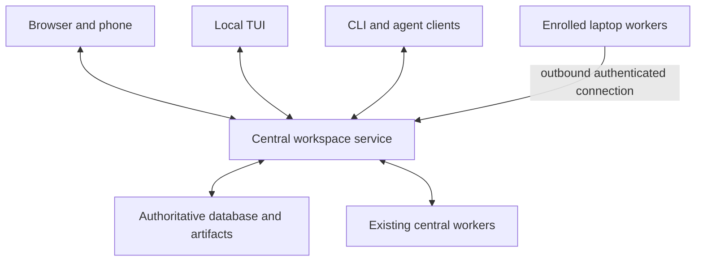

# Central Toolroll workspace and local terminal access

Status: implementation on the `central-workspace` feature branch authorized by the owner on 20 November 2026, following review of this plan. Work proceeds in dependency order through Codex builders and independent reviews. Branch authorization does not approve merge, deployment, new live execution grants, or enabling interactive attach. Baseline: released 0.9.116, main `94542be44d44b7a8bcef29862367ee61fe45aff5`.

## Decision and intended outcome

Build one authoritative Toolroll workspace with browser, terminal, CLI and agent clients. People can change clients without moving, copying or restarting their work. Add explicitly enrolled laptop execution after the remote terminal experience works with the existing central executor.

The foundation is sufficient to build on, but this is not a connection-setting change. Durable tasks, approvals, identities, grants, command handling, leases and the engine contract exist. Remote-person TUI admission, portable project identity, cross-device result transport and safe laptop execution are substantive new work.

Initial audience: one person or a small trusted team, one central installation, existing Git repositories, macOS and Linux clients. Personal mode remains a first-class workspace requiring no team setup. Everyone's tasks can live centrally; each person sees only authorized projects. Presence and shared membership never grant execution or approval authority.

The first deliverable is a team server viewed from a local TUI, not distributed laptop execution. A central workspace is not the same thing as hosted SaaS: it can run on the owner's machine or a dedicated Linux server. Use the existing supported deployment and database first.

## Foundation audit

This is a source/contract audit, not a new end-to-end proof. Existing release verification is useful baseline evidence, not coverage for the proposed feature.

| Area | Released foundation | Gap or constraint | Primary code or document |
| --- | --- | --- | --- |
| Durable work | Tasks, attempts, scope approvals, results, history and check status | Keep existing identities and semantics across clients; no parallel team task store | `src/store.ts`, `src/operate.ts`, `docs/agents.md` |
| Human identity | Browser sessions, API tokens, OIDC and project access | Remote TUI must act as the signed-in person, not the server owner | `src/api-tokens.ts`, `src/oidc.ts`, `src/server/session.ts` |
| Remote commands | Classified `/api/cli` dispatch, principal rechecking, keyed mutations, CLI profiles | Remote approvals retain existing step-up restrictions; deprecated profile UX needs a replacement/migration decision | `src/remote-exec.ts`, `src/operate-remote.ts`, `src/operate-remote-arguments.ts`, `src/connect-cli.ts` |
| Agent access | Local coordinator MCP and smaller team HTTP MCP | Different tool coverage; no automatic session/context synchronization with another manager | `docs/agents.md`, `src/server/remote.ts`, `src/mcp-connect.ts` |
| Terminal client | Typed engine responses, contract version/digest, browser-owned actions and live views | Admission is deliberately loopback-only local-owner; cannot accept a remote URL with that authority | `tui/crates/toolroll-api/src/client.rs`, `src/contracts/engine-api.ts`, `src/server/engine-api.ts` |
| Live updates | SSE invalidations, bounded live windows and cursors | Do not assume global durable event replay or remote-run output transport exists | `tui/crates/toolroll-api/src/sse.rs`, `src/server/engine-api.ts`, `src/live-main-read.ts` |
| Project identity | Real-path resolution with strict authorization checks | A server path is not portable identity; add stable public IDs without weakening path checks | `src/project-identity.ts`, `src/project.ts` |
| Workers | Runner registration, repository binding, capacity, tokens, claims and leases | These are primitives, not proof of a laptop-safe network worker protocol. Re-registration/reaping assumptions must be audited before use across disconnected machines | `src/runner.ts`, `src/surface.ts`, `src/store.ts` |
| Results and artifacts | Existing evidence folders, diffs, checks, result identity | Current live reads explicitly depend on this computer's runner and files; remote uploads need a new validated transport | `src/server/engine-api.ts:readRunLive`, `src/engine-reads.ts`, `src/builder.ts` |
| Team hosting | Central service, TLS proxy, per-person connection, central repositories/runners | Documented setup is operationally involved; remote-team plan explicitly defers laptop runners | `docs/team-server.md`, `docs/plans/remote-team.md` |
| Interactive agent control | Reviewed attach scaffolding and a separate implementation plan | Not enabled; neither remote TUI nor this plan implies arbitrary existing PTY adoption | `docs/plans/attach-mode.md`, `docs/guide/from-herdr.md` |
| Operations | Backup, restore, compatibility and gated upgrades | Prove client/server compatibility and completion across an upgrade; avoid the old coordinator/new schema interruption observed during 0.9.116 | `src/release.ts`, `src/update*.ts`, `docs/team-server.md` |

Do not infer shipped behavior from an old plan's phase status or from a method name alone. Sprint 0 records the exact call graph and supported paths before implementation estimates become commitments.

## Product contract

There are three separate actions:

| Action | Meaning | Must not do |
| --- | --- | --- |
| Open in terminal | Show this workspace and task in the person's TUI | Copy the task, change its execution location, or restart an agent |
| Open code locally | Prepare a separate local worktree from the recorded result/base commit | Overwrite dirty files, export secrets, or claim a remote process moved locally |
| Run on this computer | Admit a new eligible attempt on an enrolled computer | Reuse a person's broad API token as a worker credential or silently widen approved terms |

Workspace, project, task, attempt, result and agent session identities are distinct. A path or Git remote supplied by a checkout is not authority to choose any of them.

Cross-client references include the immutable workspace identity as well as the existing task ID. Two installations can have the same task spelling; a browser handoff, cache entry or API response must never resolve it against whichever workspace happens to be active. Existing task IDs need not be rewritten globally.

Proposed start flow: launch Toolroll, continue the last workspace, or choose Personal / a named team. Show the workspace and account persistently but quietly. A first-time personal user does not face team/server/device configuration. A person joining a team signs in through the browser; the terminal receives a narrow, revocable connection through a server-verified enrollment, not a copied owner login.

The Work screen and terminal list use the same saved state and familiar filters: My work, Team work, Needs me. The existing status vocabulary remains unchanged. Execution location is secondary information until it explains a wait or changes consent. Before any action that changes access or execution terms, show the exact meaningful consequences.

New actions need the existing chat action or a clearly labelled route to their control. Chat can link to device enrollment and approval; it must never request a password, API token or machine secret.

## Reference implementations and best-in-class judgments

These are feature-specific architectural/UX judgments from current primary documentation, not measured competitive benchmark winners. No one product establishes the entire desired behavior.

| Feature | Best reference for this plan | Concrete pattern to borrow | Boundary |
| --- | --- | --- | --- |
| Agent-native human collaboration | [Conductor multiplayer](https://www.conductor.build/docs/cloud/collaboration); [AGOR](https://github.com/preset-io/agor) | Shared work identity, visible responsibility, shared discussion and handoff | Do not require a canvas or build presence before reliable task synchronization; Conductor's documented multiplayer is cloud-specific |
| Local interface for remote work | [VS Code Remote](https://code.visualstudio.com/docs/remote/remote-overview); [Codespaces in VS Code](https://docs.github.com/en/codespaces/developing-in-a-codespace/using-github-codespaces-in-visual-studio-code) | Keep the local interface familiar and make the remote execution boundary explicit | A local UI does not mean local files or local execution; opening a repository does not resume an agent session |
| Self-hosted central workspace with remote access | [Coder architecture](https://coder.com/docs/install/plan/architecture); [workspace access](https://coder.com/docs/user-guides/workspace-access/) | Central authority, enrolled workspace agents, liveness and multiple access clients | Copy the separation of responsibilities, not Terraform, a new database, full SSH access or automatic file sync |
| Durable agent task management and adapters | [Paperclip adapters](https://docs.paperclip.ing/reference/adapters/overview/) | A durable work item independent of a particular runtime, explicit adapter capabilities | Adapter availability does not prove arbitrary live-session adoption or equal maturity of every adapter |
| Reach a machine without custom networking | [Tailscale SSH](https://tailscale.com/docs/features/tailscale-ssh) | Identity-aware connectivity and explicit network policy | Tailnet membership is neither Toolroll project access nor permission to execute; Tailscale is optional transport |
| Durable orchestration reasoning | [Temporal workers](https://docs.temporal.io/best-practices/worker) | Persist execution state; workers obtain work separately from the service | An infrastructure analogy, not a new dependency. Retrying an activity may repeat side effects; an expired lease is not proof a process stopped |
| Terminal-native agent continuity | [Herdr agents](https://acrogenesis.com/herdr/docs/agents/); [Rex agent skill](https://www.superlogical.com/rex/docs/automate/agent-skill) | Preserve local keyboard/terminal expectations and a clear connection target | Terminal persistence is not a shared task/approval system. Live terminal control remains in the separate attach arc |
| Linux adoption environment | [Omarchy](https://omarchy.org/); [AI manual](https://omarchy.org/manual/ai/) | A credible Linux installation and existing-agent walkthrough | Omarchy is an OS/host, not this control plane; claim compatibility only after a native journey |

Recommendation: use Conductor as the collaboration interaction reference, VS Code/Codespaces as the surface-switching reference, and Coder as the architectural reference. Preserve Toolroll's exact task/approval/check semantics rather than copying a competing product wholesale.

## Architecture and authority

### Central state

Keep one authoritative central database. Off-host clients and workers mutate state through the service API, never by accessing the SQLite file. Preserve the existing trusted co-located service/worker processes and transaction rules; this plan does not require a new single-process writer architecture. Do not synchronize SQLite files, mount a shared database over NFS, or introduce Postgres merely to support a remote TUI. Database replacement, multi-region availability and mutually untrusted SaaS tenants are separate scope.

The workspace owns task state, revisions, assignments, approvals, decisions, attempt/lease ownership and accepted result/check records. Artifacts are associated with exact project/task/attempt/result identities. Reuse existing storage and handlers where suitable; add a protected transfer/storage interface before supporting off-host workers. Listing, reading, live streaming and downloading artifacts all recheck project access.

Add immutable public workspace/project identifiers alongside existing canonical server paths. Backfill them additively, keep old internal authorization paths intact, and translate public IDs on the trusted service. Device-to-project bindings are explicit local configuration admitted during enrollment. Neither client-supplied URLs nor a checkout's `.git/config` establishes a binding or grant.

### Clients and authentication

Reuse the engine's typed contract and existing action owners. Introduce a reviewed remote-person admission path and principal adapter; do not loosen the current local-owner link parser, proxy an owner session, or expose unclassified commands. A remote token must not become an owner cookie. Audit and test the identity used by every engine read and action.

Sprint 0 selects the smallest server-verified browser-to-terminal enrollment compatible with current account/session policy. It binds the intended installation, account, client and expiry; prevents replay, phishing/origin substitution and cross-workspace token reuse; and supports revocation without storing secrets in logs, URLs or project folders. Reuse existing API token/session machinery where the authority semantics match. Do not claim a new OAuth device flow exists until it is implemented and reviewed.

Retain existing step-up restrictions in the first remote TUI release. A remote approval opens the exact browser ceremony and returns to the same task automatically; plain API tokens cannot approve. Native remote-terminal approval is deferred pending its own reviewed operation-specific proof design. Explain this capability gap instead of presenting a dead control or treating local authority as portable.

The client negotiates supported API version/capabilities before mutations. Old or incompatible clients receive an actionable update message. Never silently create a personal task because a central connection failed.

### Synchronization and offline behavior

Use authoritative snapshots and revisions with the existing live invalidation machinery. Specify ordering, subscription/snapshot races, bounded buffering and reconnect reconciliation. A stale/expired cursor or server restart fetches a new snapshot. Do not start a new durable event bus unless a concrete correctness requirement cannot be met this way.

Mutations carry an idempotency key and expected task revision/digest where applicable. Check authorization and update state together. A network timeout means unconfirmed; query the command outcome before retrying. Concurrent reassignment/revision/acceptance gives one committed outcome and a clear stale-state response to the other caller.

Offline clients may show clearly dated cached reads and privately saved unsent drafts. They cannot approve, cancel, reassign or queue an automatic mutation for later delivery. Drafts and caches are scoped to workspace/account, protected from agents, and cleared according to sign-out policy. Revocation prevents future access; it cannot erase information a person already copied.

### Local files and execution

Opening code locally uses a server-recorded repository and exact commit/tree, a locally proved project binding, existing hardened Git helpers, and an isolated worktree. It leaves dirty work alone and refuses missing commits, redirects, untrusted hooks/config, symlink escapes and mismatched projects. No automatic copying of secrets, `.env`, provider settings, all project memory or arbitrary uncommitted files.

A local edit returns as an explicit candidate/revision on the original task, with an exact base and diff. It does not rewrite a reviewed result or inherit its passing check. The normal trusted check/completion/deployment path still applies.

A laptop worker gets its own narrow, revocable device identity, project bindings and per-attempt grant. Use outbound authenticated HTTPS/polling first; no new inbound port, SSH daemon or unrestricted remote shell is needed. Readiness records identify OS, verified runtime/protocol, providers/models, capacity and supported isolation. Sign-ins remain on the execution machine; the central service stores appropriate references/readiness, not copied provider credentials.

Admission binds task scope and context version, exact base, approved provider/model, executor/device, permissions, budget and lease epoch. A new location can require fresh approval; it never inherits wider access because the task ID matches. Only the current epoch may settle authoritative state or publish a result. An obsolete worker's local filesystem effects remain possible until it stops: fencing central writes is not a claim of exactly-once execution.

Worker disconnect or laptop sleep means unreachable/outcome unknown, not stopped or safe to replay. Do not automatically reassign side-effecting work merely because a heartbeat expires. Require stop/custody evidence or an explicitly reviewed recovery path before replacement work. Retire/revoke denies new admission and settlement; report the last confirmed process state honestly. Central shutdown and TUI quit are distinct from stopping an owned local attempt.

Default disconnected-worker policy: a cooperative worker cannot start new model calls, tools or child processes after its server-issued grant or lease expires or renewal has failed past the authorized validity. It attempts to stop only its owned work and reports outcome unknown until custody/stop evidence is reconciled. Reuse the existing reviewed lease/grant bounds; do not introduce a new agent execution time limit. Validate elapsed validity against monotonic time, invalidate stale authority across restart, and test clock changes and laptop sleep. Any allowance to continue beyond current authority is a separate reviewed term, not inferred from task approval. The server can immediately fence central actions after revocation; it cannot promise to physically stop an unreachable or hostile machine.

In particular, current runner-name replacement/reclaim behavior is not sufficient off-host custody evidence. A new registration using the same display name cannot prove the old machine's process stopped. Bind immutable device identity and attempt epochs independently of names, and audit existing reaper paths before enabling a network worker.

The artifact protocol names the attempt, base/result commit, paths, sizes, digests, sequence and finalization state; bounds streams and verifies admission again on settlement. It rejects traversal, symlinks, duplicate/conflicting chunks, wrong project/epoch and partial uploads. Provider output and uploaded `passed` claims are not trusted deployment proof. An enrolled device's signature proves origin, not honest execution. Initially, local results require the existing trusted central verification before deployment; expanding trusted check locations is a separate owner-approved policy.

## Sprint delivery

Planning assumption: one implementation lead and a separate Codex reviewer available for security-sensitive diffs, plus owner/tester time. Sprint 0 is approximately one week; Sprints 1–6 are nominal two-week timeboxes, not calendar promises. Split implementation into reviewable PRs. A failed security or native proof gate moves the dependent work; it does not justify a waiver or longer test limits. Remote TUI MVP is the end of Sprint 2; local code handoff follows in Sprint 3; laptop execution is a later release.

### Sprint 0 — contracts and a reproducible baseline

**Outcome:** builders can implement against an agreed authority and UX contract without guessing.

- Inventory engine reads, form actions, shared authorization helpers, remote command allowlists, artifact storage and worker custody paths on the exact baseline.
- Record decisions for public IDs, enrollment credentials, session expiry/step-up, capabilities, snapshot/reconnect ordering, local result provenance and personal/team separation.
- Produce a route/action permission matrix for reader, project member, approver, operator and device; map existing roles rather than inventing a new hierarchy without cause.
- Specify the minimal screens/terminal states and the three actions above using the owned design system. No new visual language.
- Define isolated two-person fixtures, two distinct machine/process fixtures and the failure matrix below. Preserve current local-owner regressions.
- Record acceptance targets, event names/data minimization and privacy treatment. No customer metrics are assumed to exist.

**Exit:** foundation/call-graph inventory, protocol examples, threat/authority review and concrete slice tickets agreed. No runtime feature enabled.

**Dependencies:** none. Candidate areas: `src/contracts/engine-api.ts`, `src/server/engine-api.ts`, `src/operate-remote.ts`, `src/project-identity.ts`, TUI client/session bootstrap.

### Sprint 1 — sign into a shared workspace from the TUI

**Outcome:** Alice sees her authorized central work from her laptop terminal while server workers keep running.

- Add safe remote-person admission and version/capability negotiation; preserve the existing local-owner path.
- Workspace/account selector and explicit personal mode. Migrate/deprecate existing CLI profiles without losing saved connections or silently selecting another server.
- Implement authorized task/project lists, task detail, decisions, result/check reads and server-local live output through the typed contract.
- Reconcile after network loss, server restart, logout, token/account revocation and project access changes. Include redacted diagnostics that never print credentials.
- Keep remote approval and unsupported capabilities visibly routed to the exact browser control.

**Exit proof:** two accounts with different project grants cannot enumerate or read each other's private work; a revoked session receives no new output; an incompatible server produces an update path; central outage never starts a local database/worker accidentally. Local personal flow remains intact.

**Review:** separate Codex review of auth, engine admission, token handling and output authorization before merge. Reuse focused TS/Rust contracts plus actual local and remote TLS admission checks; do not run a manual whole suite.

### Sprint 2 — work interchangeably in browser and terminal

**Outcome:** changes made in either client appear on the same task and every allowed action has a recoverable outcome.

- Enable the existing permitted create, steer, answer, revision and completion actions through their shared action owner; keep actual status/check semantics.
- Preserve drafts, show responsibility, and provide My work / Team work / Needs me consistently. Add only the assignment/handoff controls the existing domain can support safely.
- Bind mutations to revision/idempotency and reconcile uncertain responses. Enforce permissions again at commit, not at initial screen load.
- Add a task-targeted terminal opening handoff. First version may copy a documented, validated command referencing a saved workspace profile and task ID; exact syntax is decided in Sprint 0 and is not a released command today. No bearer secret in links or commands, and no arbitrary remote URL silently enrolled.
- Browser step-up returns to the exact task in the TUI; state which actions still require that browser step.

**Exit proof:** Alice files in browser, Bob opens in TUI, Alice answers a question, Bob requests a revision and reviews the new result. One task identity/history survives. Concurrent accept/revision, repeated clicks, lost responses, revoked access and reconnect yield no duplicate attempts or stale approval. TUI quit never stops central work.

**Release boundary:** central workspace + remote TUI MVP. Real desktop browser, phone viewport and narrow/wide terminal journeys; explicit physical-phone/IME gaps. Pilot this before waiting for laptop execution.

### Sprint 3 — open exact code locally and return a revision

**Outcome:** a person can inspect/edit a central task locally without copying tasks or clobbering their checkout.

- Add portable public project IDs and explicit local bindings if the read-only mapping did not require them earlier; retain canonical server path authorization.
- Fetch only from admitted repository records, prove exact base/result objects, and create a separate local worktree. Explain a missing repository/commit as a fixable condition.
- Open the same task alongside its local code. Implement a protected, bounded candidate-transfer/admission slice in this sprint before promising return of local changes: exact base/result commit and tree, allowlisted paths, size limits, current project/person admission, conflict/partial-transfer refusal and provenance. The existing revision form is not assumed to import arbitrary local edits. Return a deliberate revision candidate through that slice; central authorization, check and human review remain authoritative. Sprint 5 extends/reuses this transfer foundation for worker progress and result artifacts.
- Preserve dirty files; refuse wrong repository, local hooks/config tricks, symlink escape and branch movement. Large files, LFS and private dependencies have explicit supported/unsupported states.

**Exit proof:** two machines with different folder paths open the same central task/result; an existing dirty checkout remains unchanged; a local revision returns to the same task and loses stale check/approval standing where appropriate. A wrong base/tree/project, excessive upload, interrupted transfer or grant revoked before admission cannot become an accepted candidate. No claim that a native agent process or arbitrary uncommitted context moved.

**Review:** separate Codex review of Git/path authority, transfers and candidate admission. Remote TUI MVP remains usable if this sprint is delayed.

### Sprint 4 — enroll execution devices, without dispatching work

**Outcome:** a person can safely register, inspect, pause and revoke a laptop as an execution location.

- Add reviewed device enrollment, narrow credentials and project bindings through an outbound connection.
- Expose readiness/capabilities, capacity, runtime version and last contact; separate signed-in human, device owner and task approver.
- Define per-attempt admission, lease/epoch, cancellation/revocation and unknown-outcome contracts before opening dispatch.
- Make enrollment and project enablement explicit. A team member or remote operator cannot silently enable execution on another person's laptop.
- Bound/control update compatibility; test that a service/schema upgrade can finish under the correct verified coordinator rather than stranding an old process.

**Exit proof:** replayed enrollment, wrong workspace, stolen/revoked device credential, changed project binding and unsupported isolation all refuse. Grant expiry, failed renewal, clock rollback, laptop sleep and restart cannot silently extend permission to start work. Enrolling a device starts no agent. Device controls are understandable on desktop and phone; password/secret setup uses existing protected ceremonies.

**Review:** independent Codex review of the complete device authority diff and native boundary evidence before any dispatch feature flag can open.

### Sprint 5 — run eligible work on a laptop and return evidence

**Outcome:** an explicitly approved task attempt runs on an eligible laptop, while central state and review stay consistent.

- Dispatch only through the admitted per-attempt contract; use existing sandbox, Git and custody helpers rather than a generic remote shell.
- Transport bounded progress, saved result/diff and artifact manifests to protected central storage. Finalize atomically after checking current project/device/lease/approval state.
- Keep checks, completion and deployment distinct; trusted central verification remains required for local candidate deployment initially.
- Implement cancellation and recovery with exact owned process evidence. Sleep, Wi-Fi loss, worker/server restart and lease expiry retain uncertain outcomes and cannot silently cause duplicate side effects.
- Display the execution machine when relevant. Changing it produces the necessary new terms/approval, not an automatic migration.

**Exit proof:** a real native task runs on Mac and Linux from a central queue; correct output/result reaches both clients; a retired or stale worker cannot publish a result; a partial upload is not Ready; a failed check stays failed. Kill/disconnect at each admission/start/result/finalization boundary and prove the truthful state and safe next action. A host-specific job cannot run on an arbitrary second host lacking the bound project.

**Review:** independent final security diff/evidence review, native isolation/custody attacks and focused provenance tests before opt-in pilot. Do not claim cryptographic proof of honest checks from an untrusted device signature.

### Sprint 6 — pilot, upgrade and operational readiness

**Outcome:** outside users can repeat the whole experience, and operators can maintain it without bespoke repair.

- Run the common user protocol below; fix observed first-run, handoff and recovery friction before broad promotion.
- Verify backup/restore covers database plus accepted artifacts consistently; interrupted transfers and reconnects recover after restore without replaying stale authority. Restoration must establish a fresh recovery generation and require appropriate re-proof so old sessions, device grants, leases or a backed-up pre-revocation state cannot regain standing. Specify this in the Sprint 0 authority design; do not assume a database restore itself is safe authorization recovery. Define retention, disk exhaustion and artifact garbage collection.
- Complete compatibility/upgrade and rollback policy with additive schema changes, client/server version skew and native worker drain. No direct database downgrade or unproved old-runtime restart.
- Publish tested central server, remote TUI and local worker guides. Reconcile obsolete claims in `remote-team.md`, `team-server.md`, `from-herdr.md` and attach status when the corresponding behavior ships.
- Exercise Omarchy natively before claiming its installation/fence journey; retain macOS and supported Linux coverage. Windows clients/workers require their own supported-platform decision and proof.
- Use the normal exact-candidate release gate. No repeated whole-suite lead inspection; changed failures get focused verification, then the required approved final machine check.

**Exit:** no unresolved blocker for identity isolation, duplicate execution, loss of reviewed work or misleading outcome. Remaining supported-platform and physical-device gaps are explicit. A small-team operator can restore and reconnect using the guide, without the builder's assistance.

## Common examples and acceptance protocol

1. **Solo across surfaces:** Alex queues a change in the browser, opens the same task in the laptop TUI, quits the TUI, and later reviews it from a phone. The agent keeps running at its recorded location; review/check status and task identity agree everywhere.
2. **Two-person handoff:** Alice owns a bug task; Bob has that project grant. Alice reassigns it; Bob sees the brief, decisions, exact diff/checks and next action. A third person without access cannot discover the task or artifacts. Presence does not grant a write.
3. **Local inspection:** Bob opens code locally with unrelated uncommitted changes already in his checkout. A separate worktree is prepared from the recorded commit. His deliberate revision returns to the original task and receives fresh applicable verification.
4. **Local execution:** Alex explicitly enables one project on a laptop. The chosen attempt runs there using its admitted model and permissions. A server-side viewer can observe the authorized task; an unrelated project cannot use the device.
5. **Interrupted attempt:** the laptop loses network after a potentially side-effecting operation. Both clients show unreachable/unknown delivery, not a false failure or second attempt. Reconnection reconciles the original attempt; a replacement needs the defined stop/recovery proof.
6. **Revocation:** remove Bob's project access while he has a TUI, browser and artifact stream open. No new unauthorized bytes/actions are admitted. Previously copied material is not falsely claimed erased.
7. **Provider change:** a device lacks the approved provider/model or loses sign-in. It reports unavailable and waits; another provider/device is not silently substituted. The existing explicitly enabled teammate backup is not general permission for task execution fallback.

Initial research cohort: 20 outside people, for example 12 solo participants and four pairs, including people who already use Herdr/Rex, an agent app and an ordinary CLI. Targets below are proposed experiment thresholds, not achieved results or evidence of market leadership:

- At least 80% can connect and start useful work within five minutes without coaching; measure model execution time separately.
- At least 80% complete the review/revision loop without coaching.
- At least 80% of recipients identify the correct next action within one minute of a handoff.
- All security acceptance cases preserve project/device authority and truthful unknown states; unresolved critical failures block rollout regardless of UX success.
- Record voluntary week-one return and preference against the participant's existing tool, with reasons; do not manufacture a target score from feature count.

Use isolated synthetic journeys for reproducible security/contract behavior and consenting real users for usability. Do not send invitations or collect customer data merely because this plan names a cohort. Keep product telemetry minimal; task content, credentials and raw terminal output are not analytics payloads.

## Failure and review matrix

Every sprint selects tests for its concrete changes. Security rules, migrations, data integrity and contracts get focused regressions; markup/wording changes use actual visual journeys rather than mirror tests.

| Risk | Required proof before affected release |
| --- | --- |
| Remote user receives local-owner powers | Role/principal matrix, account/project revocation, replay/cross-origin/cross-workspace attacks |
| Client shows stale or unauthorized output | Subscribe/snapshot race, bounded backlog, cursor expiry, server restart, recheck before delivery |
| Two actions create duplicate work | Same key replay, lost acknowledgement reconciliation, revision conflict, transactional authorization/write |
| Paths or Git metadata select authority | Trusted project/device binding, realpath and symlink tests, hardened Git against hostile config/hooks/refs |
| Offline worker continues while replacement starts | Native custody/stop proof, stale epoch settlement refusal, deny new starts after authority expires, monotonic validity/restart tests, visible unknown state, no unsafe automatic failover |
| Uploaded artifacts impersonate evidence | Exact attempt/result manifest, traversal/size/partial/conflict tests, trusted check provenance and atomic finalization |
| Logout, reset or device retirement leaves authority live | Relevant transaction-level revocation and no post-revocation admission/settlement; honest remote stop uncertainty |
| Upgrade strands clients/workers | Supported skew negotiation, restart/re-enroll behavior, verified coordinator handoff, backup/restore and drain |
| Solo experience becomes team setup | No-team first run, last-workspace/account clarity, one primary action, narrow terminal and desktop/phone checks |

Auth, device authority, Git trust boundaries and result/deployment provenance require separate Codex review of the final exact diff and evidence. Scaffolding review is not enablement. Preserve failed/incomplete evidence under ignored `evidence/`; do not relabel it after a later pass.

## Scope boundaries and unresolved choices

- No multi-tenant hosted SaaS, multi-region control plane, database replacement, automatic bidirectional working-tree sync, arbitrary remote shell, universal third-party session adoption or native process migration in this plan.
- Interactive attachment remains the separate `attach-mode.md` arc with its own authority, controller-lease and native terminal proof. A remote task TUI does not need it to be useful.
- No new flow/subagent/starter-kit/email/eval capability is implied. Respect the existing feature freeze; scheduling existing work and displaying existing workflow state must not become an unrelated workflow redesign.
- Decide precise enrollment credential/session semantics, public-ID mapping and artifact/check trust policy in Sprint 0. Builders must not improvise them during implementation.
- Decide task assignment actions from the existing domain before promising live co-editing, presence or a new role hierarchy. Read access, task control and raw terminal control are different grants.
- Decide initial local-execution privacy expectations: centrally retained context/results versus local-only material, and whether any device can be considered a trusted check location. Default to bounded disclosure and central trusted verification.
- Estimate after Sprint 0 and re-estimate after the remote TUI pilot. The proposed timeboxes are sequencing tools; the exit evidence determines readiness.

The first success claim is deliberately testable: a person can open the same authorized task in browser and local TUI, act within their permissions, disconnect and return without losing context or duplicating work. Laptop execution earns a later, separate success claim.
